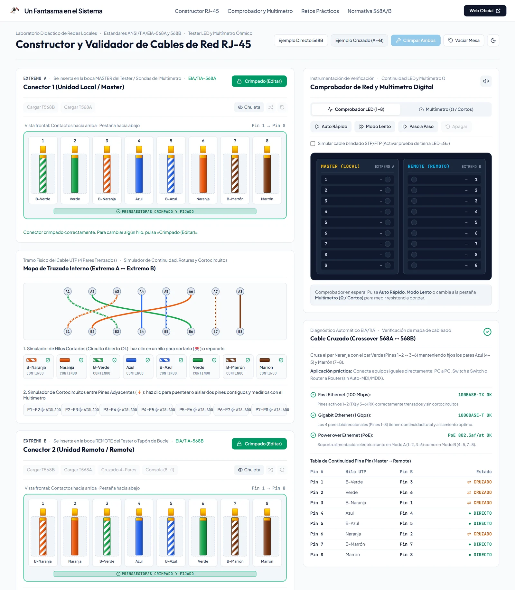
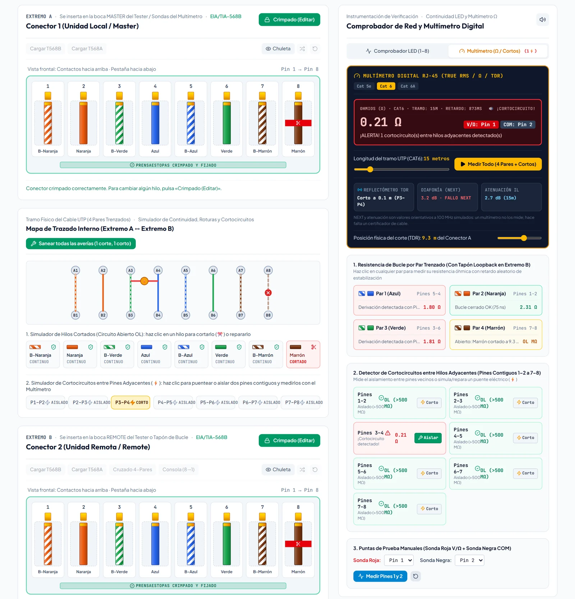
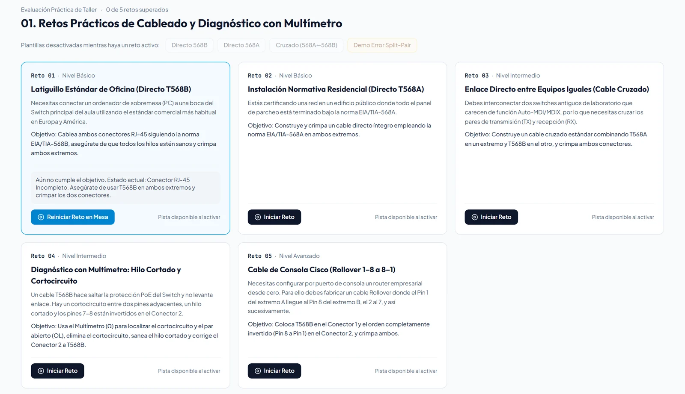
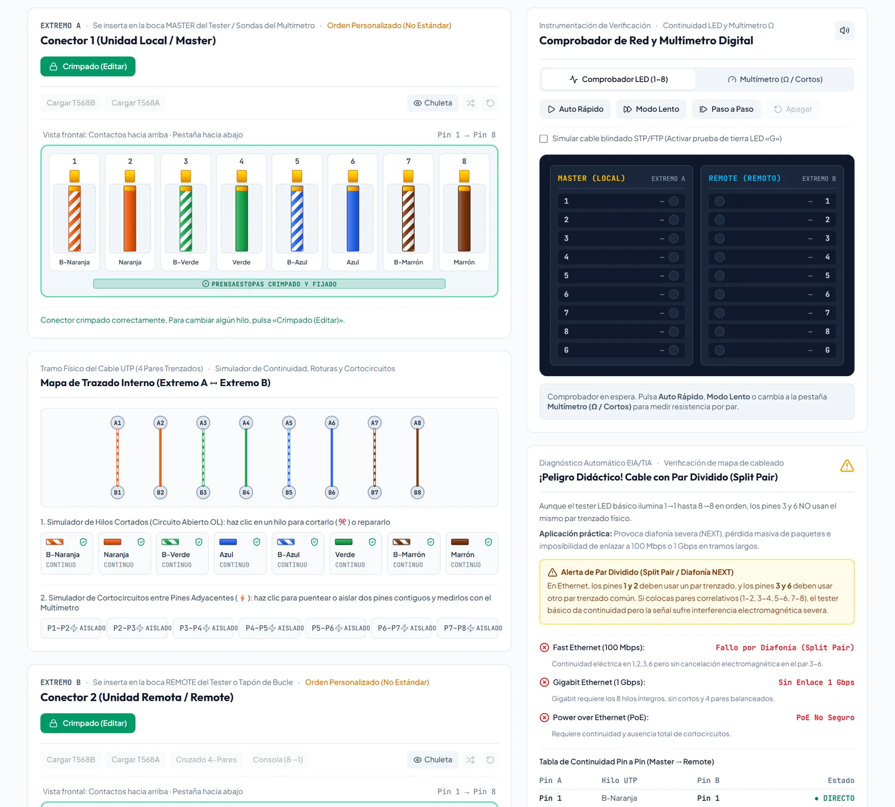

<p align="center">
  <a href="https://www.unfantasmaenelsistema.com"></a>
</p>

<h1 align="center">Constructor y Validador de Cables RJ-45</h1>

<p align="center">
  <b>Monta latiguillos UTP hilo a hilo, crímpalos y compruébalos con un tester LED y un multímetro</b><br>
  Normas TIA/EIA-568A y 568B · Directo, cruzado, cruzado Gigabit y consola · Hilos cortados, cortocircuitos y par dividido · 5 retos de taller
</p>

<p align="center">
  <a href="https://unfantasmaenelsistema.github.io/Constructor-Validador-Cables-RJ-45/"><b>▶ Abrir el constructor</b></a> ·
  <a href="#qué-hace">Qué hace</a> ·
  <a href="#los-5-retos">Los 5 retos</a> ·
  <a href="#qué-se-aprende">Qué se aprende</a> ·
  <a href="#desarrollo">Desarrollo</a> ·
  <a href="https://www.unfantasmaenelsistema.com">unfantasmaenelsistema.com</a> ·
  <a href="LICENSE">MIT</a>
</p>

<p align="center">
  
  
  
  
</p>

<p align="center">
  
</p>

Un taller de crimpado sin gastar conectores: se colocan los 8 hilos en cada RJ-45 (con clic, arrastrando o con el teclado), se crimpa y se prueba el cable como en el aula. La app reconoce la norma de cada extremo y el tipo de cable, y explica si funcionará a 100 Mbps, a 1 Gbps y con PoE. También se pueden cortar hilos o provocar cortocircuitos para practicar la localización de averías con el multímetro.

> [!NOTE]
> Todo funciona en el navegador, sin servidor. Los retos superados y el tema se guardan solo en el `localStorage` de ese navegador.

## Qué hace

- **Dos conectores RJ-45** con vista frontal (contactos arriba, pestaña abajo, pin 1 a la izquierda), bandeja de hilos, chuleta superpuesta de T568A o T568B y crimpado: una vez crimpado, para cambiar un hilo hay que «abrir» el conector.
- **Detección automática** de la norma de cada extremo y del tipo de cable: directo T568A o T568B, cruzado 568A↔568B, cruzado Gigabit de 4 pares (1↔3, 2↔6, 4↔7, 5↔8), consola o *rollover* (1↔8…8↔1) y **par dividido** (*split pair*).
- **Compatibilidad del enlace**: 100BASE-TX (pines 1-2 y 3-6), 1000BASE-T (los 4 pares) y PoE en modo A y B, con el motivo de cada fallo (por ejemplo, un hilo marrón cortado deja el Gigabit en 100 Mbps).
- **Tester LED** secuencial (rápido, lento o paso a paso), con prueba de blindaje para cable STP/FTP.
- **Multímetro**: resistencia de bucle de cada par con tapón *loopback* en el extremo B, detector de cortocircuitos entre pines vecinos, puntas de prueba manuales y reflectómetro TDR para situar un corte. La diafonía (NEXT) y la atenuación se muestran como valores orientativos simulados.
- **Averías**: cortar o reparar cualquier hilo y puentear o aislar dos pines contiguos.
- **Referencia**: guía paso a paso del crimpado, tabla de pines T568A/T568B con señales de Fast Ethernet, Gigabit y PoE, y cuándo usar cable directo o cruzado.
- **Informe de verificación** descargable con el mapa de cableado pin a pin y el estado del enlace.

<p align="center">
  
</p>

## Los 5 retos

| # | Reto | Nivel | Qué hay que conseguir |
| :-: | :-- | :-: | :-- |
| 01 | Latiguillo estándar de oficina | Básico | Cable directo T568B en los dos extremos, crimpado. |
| 02 | Instalación normativa | Básico | Cable directo T568A en los dos extremos, crimpado. |
| 03 | Enlace entre equipos iguales | Intermedio | Cable cruzado: T568A en un extremo y T568B en el otro. |
| 04 | Diagnóstico con multímetro | Intermedio | Encontrar y reparar un cortocircuito, un hilo cortado y los pines 7-8 invertidos. |
| 05 | Cable de consola | Avanzado | *Rollover*: el conector 2 en orden inverso al conector 1. |

Mientras hay un reto en curso, las plantillas («Cargar T568B», «Ejemplo directo», etc.) y el botón de reparar todas las averías se desactivan: el cable se monta hilo a hilo y cada avería se localiza y se repara por separado. El reto se da por superado cuando el cable cumple el objetivo y está crimpado en los dos extremos.

<p align="center">
  
</p>

## Qué se aprende

- **T568B**: blanco-naranja, naranja, blanco-verde, azul, blanco-azul, verde, blanco-marrón, marrón. **T568A** intercambia el par naranja y el verde.
- Un **cable directo** une puertos de distinto tipo (MDI con MDI-X: PC a switch, router a switch); el **cruzado**, puertos del mismo tipo cuando no hay detección automática (Auto-MDI/MDIX).
- El **par dividido** da continuidad 1-1…8-8 en un tester básico, pero los pines 3 y 6 no van por el mismo par trenzado: hay diafonía y el enlace falla.
- Un tester o un multímetro **verifican** el mapa de cableado; **certificar** un enlace exige un certificador que mida NEXT, pérdida de inserción y retardo según TIA-568.2-D o ISO/IEC 11801.

<p align="center">
  
</p>

## Desarrollo

Requisitos: Node.js 20 o superior.

```bash
git clone https://github.com/unfantasmaenelsistema/Constructor-Validador-Cables-RJ-45.git
cd Constructor-Validador-Cables-RJ-45
npm ci
npm run dev      # http://localhost:3000
npm test         # 22 tests de las normas, el análisis del cable y los retos
npm run lint     # comprobación de tipos
npm run build    # versión estática en dist/
```

Cada `push` a `main` pasa por el workflow [`deploy.yml`](.github/workflows/deploy.yml) (tipos, tests y build) y se publica en GitHub Pages. Los pull requests ejecutan las mismas comprobaciones sin publicar.

```text
src/
├── data/cableStandards.ts        Normas, análisis del cable (tipo, enlace, PoE, averías) y retos
├── data/cableStandards.test.ts   Tests (Vitest), incluidos 5.000 conectores al azar
├── App.tsx                       Mesa de trabajo, retos y progreso
└── components/                   Conectores, mapa de trazado, tester LED, multímetro y referencia
```

## Novedades de la versión 2

- **Los retos se superaban con un clic**: los ejemplos de la cabecera, las plantillas de la referencia y los «Cargar T568B/T568A» de cada conector seguían activos durante un reto, y el reto 04 se resolvía con «Sanear todas las averías». Ahora están desactivados mientras hay un reto en curso.
- **«Certificación»**: el informe decía «APTO / CERTIFICADO» con una simple prueba de continuidad. Ahora es un informe de verificación, con una nota que explica la diferencia, y el multímetro indica que NEXT y atenuación son valores simulados.
- Un cable directo une puertos de distinto tipo (MDI ↔ MDI-X), no «equipos de distinta capa».
- Los pines del conector se pueden usar con teclado y lector de pantalla; los retos superados y el tema se guardan entre visitas.
- Fuera dependencias sin uso (Gemini, Express) y las capturas dibujadas en SVG; se arregla la instalación con npm, el diseño ya no se desborda en móvil ni hasta 1280 px, CSP en la build y licencia MIT.

## Créditos y licencia

Desarrollado para **[Un Fantasma en el Sistema](https://www.unfantasmaenelsistema.com)**. Distribuido bajo licencia [MIT](LICENSE).
