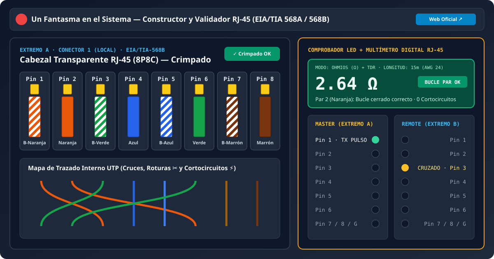
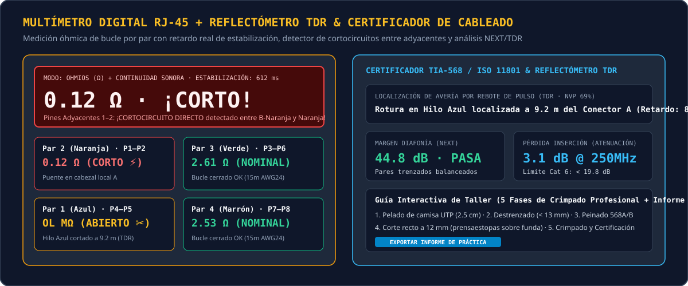
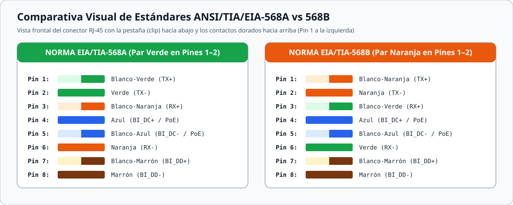

<div align="center">
  <a href="https://www.unfantasmaenelsistema.com/" target="_blank">
    
  </a>

  # Constructor y Validador de Cables de Red RJ-45 (EIA/TIA 568A / 568B)

  **Simulador interactivo de cableado estructurado UTP/STP, Comprobador Secuencial LED y Multímetro Digital (Ω / TDR / NEXT)**

  Creado por **[Un Fantasma en el Sistema](https://www.unfantasmaenelsistema.com/)** · Listo para desplegar en **GitHub Pages**
</div>

---

## 📸 Capturas de Pantalla de la Aplicación

### 1. Mesa de Trabajo Interactiva RJ-45 y Comprobador Secuencial LED (Master / Remote)


### 2. Multímetro Digital (True RMS / Ω), Detector de Cortocircuitos Adyacentes y Reflectómetro TDR


### 3. Esquema Técnico Comparativo de Normas EIA/TIA-568A y EIA/TIA-568B


---

## 🎯 ¿Qué hace esta aplicación?

Esta herramienta web educativa e interactiva simula un **laboratorio real de cableado estructurado y certificación de redes locales**. Permite a estudiantes, docentes de informática/telecomunicaciones (SMR, ASIR, DAW, Ingeniería) y técnicos practicar la construcción, el crimpado y el diagnóstico de latiguillos **RJ-45 (8P8C)** sin gastar material fungible.

### Características Principales

1. **Constructor Visual de Cabezales RJ-45 (Arrastrar y Soltar / Clic para Intercambiar)**:
   - Ordena los 8 hilos de los 4 pares trenzados (`Blanco-Naranja`, `Naranja`, `Blanco-Verde`, `Azul`, `Blanco-Azul`, `Verde`, `Blanco-Marrón`, `Marrón`) en ambos extremos del cable (**Conector 1 Local** y **Conector 2 Remoto**).
   - **Acción mecánica de Crimpado**: bloquea el prensaestopas y hunde las cuchillas doradas sobre el aislante con retroalimentación visual y sonora sintetizada mediante *Web Audio API*.
   - **Chuleta visual opcional**: muestra u oculta en cada pin el color correspondiente de la norma **T568A** o **T568B**.

2. **Simulador Físico de Averías (Roturas ✂️ y Cortocircuitos ⚡)**:
   - **Corte de Hilos Individuales**: permite cortar o reparar cualquiera de los 8 conductores en el tramo del cable para observar cómo responde el comprobador LED y cómo mide circuito abierto (`OL MΩ`) el multímetro.
   - **Inyector de Cortocircuitos entre Pines Adyacentes (`P1–P2` a `P7–P8`)**: permite puentear eléctricamente pines contiguos (simulando cuchillas dobladas o hilos pelados tocándose dentro del cabezal).

3. **Comprobador de Cable de Red con LEDs (Master + Remote)**:
   - Barrido secuencial de los pines `1` al `8` más el hilo de drenaje/blindaje `G` (para cables **STP/FTP**).
   - Modos de operación: **Auto Rápido**, **Modo Lento**, **Paso a Paso Manual** e inyección directa haciendo clic en cualquier fila LED.
   - Si dos pines adyacentes están en cortocircuito, ambos LEDs se iluminan simultáneamente en rojo (`⚡ CORTO`), replicando el comportamiento real de un comprobador físico.

4. **Multímetro Digital RJ-45 (Ω / Continuidad) + Reflectómetro TDR**:
   - **Retardo aleatorio realista de estabilización (`340 ms – 850 ms`)**: simula el auto-rango y la carga capacitiva del par antes de fijar la lectura en ohmios ($\Omega$).
   - **Resistencia de bucle por par trenzado**: calcula la resistencia DC real según la longitud seleccionada (`2 m` a `90 m`) y la categoría (`Cat 5e`, `Cat 6`, `Cat 6A`).
   - **Detector de cortocircuitos entre hilos adyacentes**: mide el aislamiento entre pines vecinos (`> 500 MΩ` en estado sano frente a `0.08 Ω – 0.22 Ω` con alarma sonora cuando existe un puente eléctrico).
   - **Reflectómetro de Dominio de Tiempo (TDR) y Diafonía (NEXT)**: calcula la distancia en metros y nanosegundos hasta el corte o cortocircuito ($NVP = 69\%$) y alerta sobre el **error de Par Dividido (*Split Pair*)** cuando los pines 3 y 6 no utilizan el mismo par físico.

5. **5 Retos Prácticos Autocorregibles, Guía de Taller en 5 Fases y Generador de Informes**:
   - Casos prácticos guiados (Cable Directo 568B, Directo 568A, Cruzado 568A↔568B, Diagnóstico de Avería con Multímetro y Cable Consola Rollover).
   - Exportación de **Informe Técnico de Certificación** en texto (`.txt`), portapapeles o vista imprimible/PDF para entregar en prácticas de aula.

---

## 📋 Tabla de Referencia Rápida: EIA/TIA-568A vs EIA/TIA-568B

| Pin RJ-45 | Norma T568A | Norma T568B | Señal 10/100BASE-TX | Señal 1000BASE-T (Gigabit) | PoE Modo A / Modo B |
| :---: | :--- | :--- | :--- | :--- | :--- |
| **Pin 1** | 🟢⚪ Blanco-Verde | 🟠⚪ Blanco-Naranja | `TX+` (Transmisión +) | `BI_DA+` (Par A +) | Modo A: `DC+` |
| **Pin 2** | 🟢 Verde | 🟠 Naranja | `TX-` (Transmisión -) | `BI_DA-` (Par A -) | Modo A: `DC+` |
| **Pin 3** | 🟠⚪ Blanco-Naranja | 🟢⚪ Blanco-Verde | `RX+` (Recepción +) | `BI_DB+` (Par B +) | Modo A: `DC-` |
| **Pin 4** | 🔵 Azul | 🔵 Azul | No usado | `BI_DC+` (Par C +) | Modo B: `DC+` |
| **Pin 5** | 🔵⚪ Blanco-Azul | 🔵⚪ Blanco-Azul | No usado | `BI_DC-` (Par C -) | Modo B: `DC+` |
| **Pin 6** | 🟠 Naranja | 🟢 Verde | `RX-` (Recepción -) | `BI_DB-` (Par B -) | Modo A: `DC-` |
| **Pin 7** | 🟤⚪ Blanco-Marrón | 🟤⚪ Blanco-Marrón | No usado | `BI_DD+` (Par D +) | Modo B: `DC-` |
| **Pin 8** | 🟤 Marrón | 🟤 Marrón | No usado | `BI_DD-` (Par D -) | Modo B: `DC-` |

---

## 🚀 Instalación y Ejecución en Local

1. **Clonar el repositorio**:
   ```bash
   git clone https://github.com/TU_USUARIO/constructor-validador-rj45.git
   cd constructor-validador-rj45
   ```

2. **Instalar dependencias**:
   ```bash
   npm install
   ```

3. **Iniciar el servidor de desarrollo**:
   ```bash
   npm run dev
   ```
   Abre `http://localhost:3000` en tu navegador.

4. **Generar compilación de producción**:
   ```bash
   npm run build
   ```
   Los archivos estáticos optimizados con rutas relativas (`base: './'`) se generarán en la carpeta `dist/`.

---

## 🌐 Cómo Desplegar en GitHub Pages (Automático)

El proyecto ya incluye el flujo de trabajo oficial de GitHub Actions en `.github/workflows/deploy.yml` y configuración de rutas relativas en `vite.config.ts`.

1. Sube este proyecto a un repositorio de GitHub (`main` o `master`).
2. En tu repositorio de GitHub, entra en **Settings** → **Pages**.
3. En la sección **Build and deployment** → **Source**, selecciona **GitHub Actions**.
4. Al hacer `git push`, la acción compilará automáticamente la aplicación y la publicará en tu URL de GitHub Pages (`https://tu-usuario.github.io/nombre-repo/`).

---

## 👤 Autor y Créditos

Desarrollado para **[Un Fantasma en el Sistema](https://www.unfantasmaenelsistema.com/)**.  
Visita **[www.unfantasmaenelsistema.com](https://www.unfantasmaenelsistema.com/)** para más recursos, herramientas técnicas, ciberseguridad, sistemas y redes.
